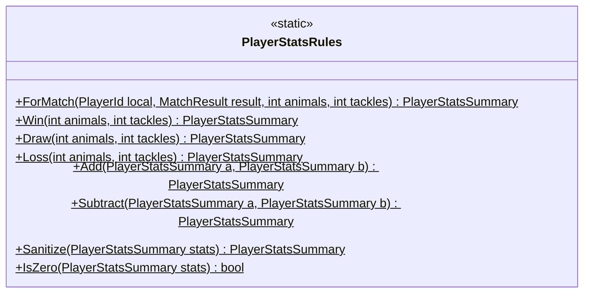

# PlayerStatsRules

> Pure accumulation rules of the lifetime stats. Saturating, never negative, no allocation.

**Módulo:** [[Modulo Networking|Networking]] · **Namespace:** `AlienFarms.Networking.Persistence` · **Archivo:** `Assets/Scripts/Networking/Persistence/PlayerStatsRules.cs`

## Diagrama

## Usa
[[MatchResult]], [[PlayerId]], [[PlayerStatsSummary]]

## Usado por
[[MatchStatsTally]], [[PendingStats]], [[PendingStatsCodec]], [[PlayerStatsCodec]], [[PlayerStatsLedger]]
