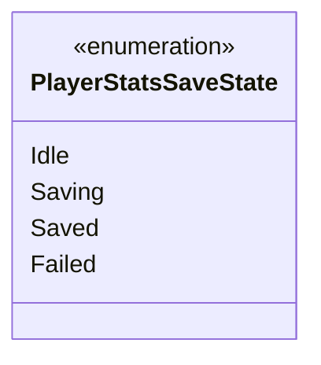

# PlayerStatsSaveState

> Save state of the `PlayerStatsLedger` (mirrors PlayerProgressSaveStatus).

**Módulo:** [[Modulo Networking|Networking]] · **Namespace:** `AlienFarms.Networking.Persistence` · **Archivo:** `Assets/Scripts/Networking/Persistence/PlayerStatsSaveState.cs`

## Diagrama

## Valores
`Idle`, `Saving`, `Saved`, `Failed`

## Usado por
[[PlayerStatsLedger]], [[PlayerStatsSync]]
