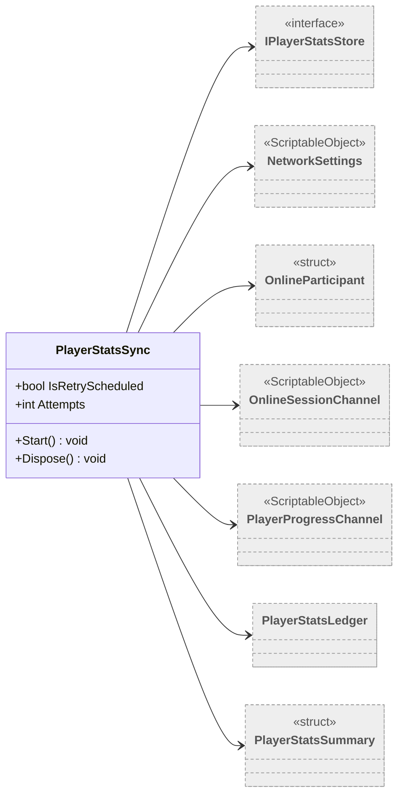

# PlayerStatsSync

> Orchestration behind `CloudSaveStatsService` (plain C#, so it is tested in EditMode with a fake store): Follows the signed-in UGS id of `OnlineSessionChannel`: a new id resets the ledger and loads. Saves whenever the ledger has something pending; conflicts are reloaded and resolved by the ledger. Retryable failures retry with backoff (delay × 3 per attempt, a Retry-After wins when longer), up to `NetworkSettings.StatsSaveAttempts`; a new round, a new account or a new root budgets again. Reads the rival's public stats while in a session (`RivalRules`, `NetworkSettings.ReadRivalStats`). Only writer of `PlayerProgressChannel` (stats, save status, rival, host-left win notice; a read-only ledger publishes its error key and, with rounds it cannot save, a failed save). One I/O at a time; event driven (no per-frame work). After every await it checks that it was not disposed and that the ledger's epoch did not change (stale results are dropped).

**Módulo:** [[Modulo Networking|Networking]] · **Namespace:** `AlienFarms.Networking.Persistence` · **Archivo:** `Assets/Scripts/Networking/Persistence/PlayerStatsSync.cs`

## Hereda / implementa
`IDisposable`

## Diagrama

## Usa
[[IPlayerStatsStore]], [[NetworkSettings]], [[OnlineParticipant]], [[OnlineSessionChannel]], [[OnlineSessionStatus]], [[PlayerProgressChannel]], [[PlayerProgressErrorKeys]], [[PlayerProgressSaveStatus]], [[PlayerStatsConflictOutcome]], [[PlayerStatsLedger]], [[PlayerStatsLoadState]], [[PlayerStatsRecord]], [[PlayerStatsSaveState]], [[PlayerStatsSummary]], [[RivalRules]], [[StatsReadResult]], [[StatsStoreOutcome]], [[StatsStoreResult]], [[Status]]

## Usado por
[[CloudSaveStatsService]]
