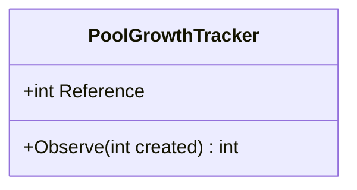

# PoolGrowthTracker

> Pure: how many instances a pool created beyond everything seen so far. Starts at the prewarm size, so instances created at load time (even when a replicated spawn arrives before the prewarm) never count as growth, while the first spawn that instantiates past it does.

**Módulo:** [[Modulo Networking|Networking]] · **Namespace:** `AlienFarms.Networking.Pooling` · **Archivo:** `Assets/Scripts/Networking/Pooling/PoolGrowthTracker.cs`

## Diagrama

## Usa
[[PoolLifecycleRules]]

## Usado por
[[NetworkPoolLog]]
