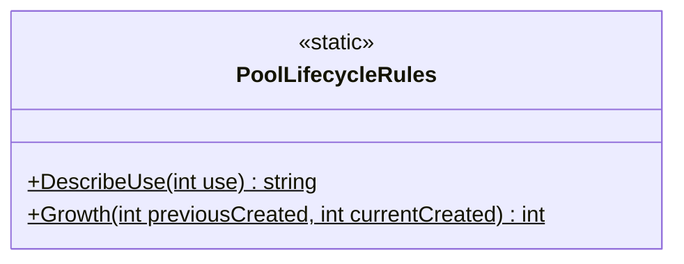

# PoolLifecycleRules

> Pure rules of the pool lifecycle log (unit tested).

**Módulo:** [[Modulo Networking|Networking]] · **Namespace:** `AlienFarms.Networking.Pooling` · **Archivo:** `Assets/Scripts/Networking/Pooling/PoolLifecycleRules.cs`

## Diagrama

## Usado por
[[PoolGrowthTracker]]
