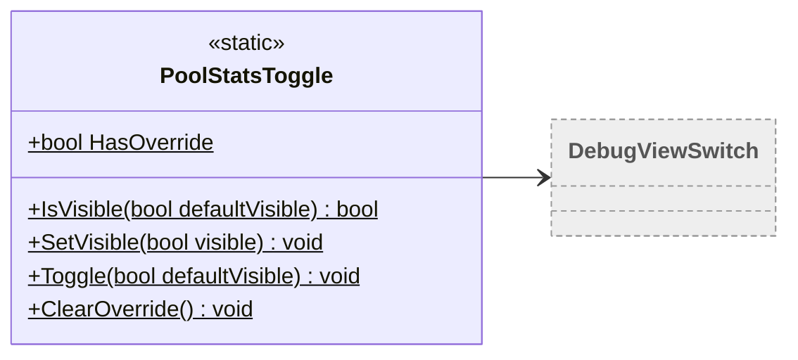

# PoolStatsToggle

> Machine-local switch of the pool / transport stats view (`PoolStatsView`). Without an override it follows NetworkSettings.ShowPoolStats; the debug overlay (F1–F4, task 3.3) calls `Toggle` / `SetVisible`. Same pattern as `OwnershipLabelToggle`. Reset on play-mode entry.

**Módulo:** [[Modulo Networking|Networking]] · **Namespace:** `AlienFarms.Networking.Diagnostics` · **Archivo:** `Assets/Scripts/Networking/Diagnostics/PoolStatsToggle.cs`

## Diagrama

## Usa
[[DebugViewSwitch]]

## Usado por
[[PoolStatsView]]
