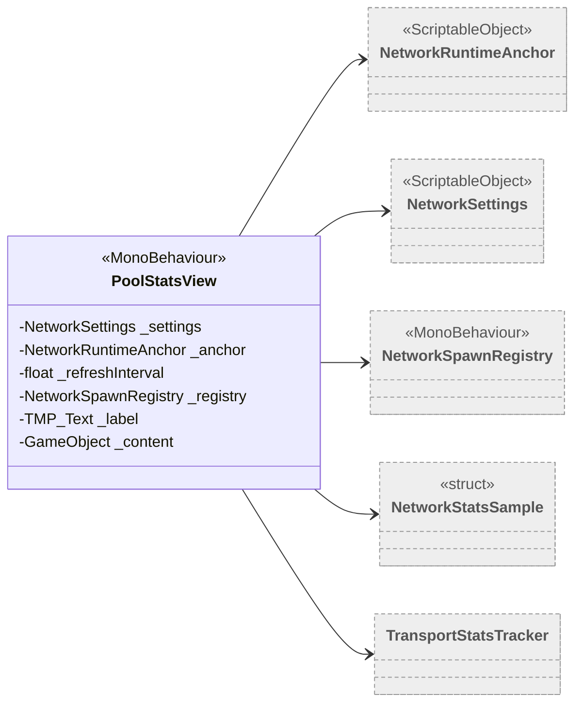

# PoolStatsView

> Online debug view (logic only; the label lives in the scene): this machine's pool counters for animals and bombs (active / in pool / created: "created" must stay flat during a match) and, while a UnityTransport runs, its receive side (packets per second, mean and max receive-queue usage against the capacity, both over the driver's lifetime) and the longest frame of the session. Works on host and clients (each has its own `NetworkSpawnRegistry`). The session is tracked every frame even while hidden; the label is sampled at `_refreshInterval` and rewritten only when a number changed, without allocating. Editor pauses and steps and application suspensions are not counted as frames. Visibility follows NetworkSettings.ShowPoolStats unless `PoolStatsToggle` overrides it (F1–F4).

**Módulo:** [[Modulo Networking|Networking]] · **Namespace:** `AlienFarms.Networking.Diagnostics` · **Archivo:** `Assets/Scripts/Networking/Diagnostics/PoolStatsView.cs`

## Hereda / implementa
`MonoBehaviour`

## Diagrama

## Usa
[[NetworkPoolStats]], [[NetworkRuntimeAnchor]], [[NetworkSettings]], [[NetworkSpawnRegistry]], [[NetworkStatsFormatter]], [[NetworkStatsSample]], [[PoolStatsToggle]], [[TransportStatsTracker]]
