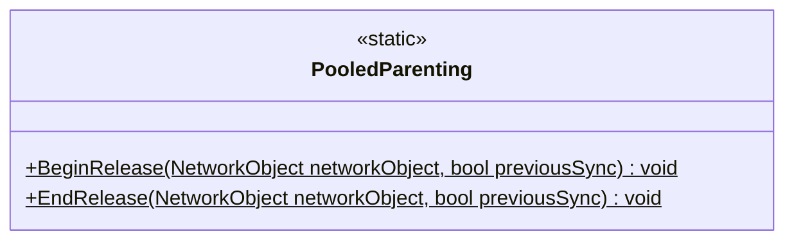

# PooledParenting

> Lets a pool put a despawned `NetworkObject` back under its (non-network) container. NGO reverts and logs an error for any parent change of a NetworkObject that is not spawned, so parent sync is switched off for the duration of the release only. Call `BeginRelease` / `EndRelease` around the pool's Release, always after Despawn.

**Módulo:** [[Modulo Networking|Networking]] · **Namespace:** `AlienFarms.Networking.Pooling` · **Archivo:** `Assets/Scripts/Networking/Pooling/PooledParenting.cs`

## Diagrama

## Usado por
[[NetworkAnimalPoolHandler]], [[NetworkBombPoolHandler]], [[NetworkSpawnRegistry]]
