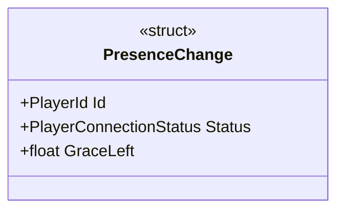

# PresenceChange

> One `GameEvents.OnPlayerConnectionChanged` to raise, as found by `SeatPresenceRules`.

**Módulo:** [[Modulo Networking|Networking]] · **Namespace:** `AlienFarms.Networking.Match` · **Archivo:** `Assets/Scripts/Networking/Match/PresenceChange.cs`

## Diagrama

## Usa
[[PlayerConnectionStatus]], [[PlayerId]], [[Status]]

## Usado por
[[NetworkSeatPresence]], [[SeatPresenceRules]]
