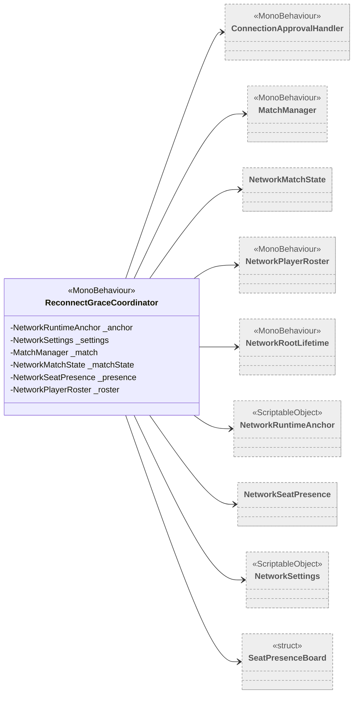

# ReconnectGraceCoordinator

> Server-only composition of the reconnection grace in the gameplay scene (under OnlineModeRoot). While it lives the approval handler keeps a dropped player's seat (`ConnectionApprovalHandler.SetGraceEnabled`): Seat reserved: the match is suspended (only in the phases `MatchSuspendRules.SuspendsIn`) and its round clock frozen. Seat restored (its avatar spawned again), released as Left or TimedOut: once no seat awaits anybody the clock resumes and the suspension ends (the match then aborts by itself if a player is missing). A timed-out member is removed from the online session. The host leaving on purpose (`NetworkRootLifetime.HostLeaveStarted`): the match is suspended and its clock frozen for good, so nothing ends or scores while the clients get the leaving notice. After every change the seat presence board is rebuilt from the seat table and written to `NetworkSeatPresence`, the single emitter of `GameEvents.OnPlayerConnectionChanged`. Disabled off the server.

**Módulo:** [[Modulo Networking|Networking]] · **Namespace:** `AlienFarms.Networking.Match` · **Archivo:** `Assets/Scripts/Networking/Match/ReconnectGraceCoordinator.cs`

## Hereda / implementa
`MonoBehaviour`

## Diagrama

## Usa
[[ConnectionApprovalHandler]], [[MatchManager]], [[MatchPhase]], [[MatchSuspendRules]], [[NetworkMatchState]], [[NetworkPlayerRoster]], [[NetworkRootLifetime]], [[NetworkRuntimeAnchor]], [[NetworkSeatPresence]], [[NetworkSettings]], [[OnlineSessionService]], [[PlayerConnectionStatus]], [[PlayerId]], [[PlayerSlot]], [[ReconnectGraceRules]], [[SeatPresenceBoard]], [[ServerSlotDirectory]]
