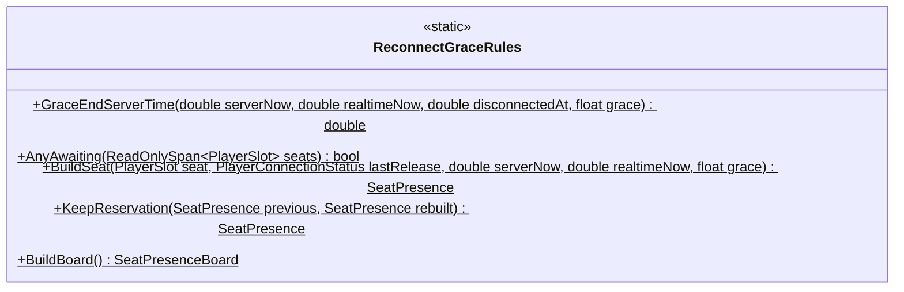

# ReconnectGraceRules

> Pure rules of the `ReconnectGraceCoordinator`: the seat table (realtime clock) turned into the replicated `SeatPresenceBoard` (server clock). No allocation.

**Módulo:** [[Modulo Networking|Networking]] · **Namespace:** `AlienFarms.Networking.Match` · **Archivo:** `Assets/Scripts/Networking/Match/ReconnectGraceRules.cs`

## Diagrama

## Usa
[[PlayerConnectionStatus]], [[PlayerSlot]], [[SeatPresence]], [[SeatPresenceBoard]], [[Status]]

## Usado por
[[ReconnectGraceCoordinator]]
