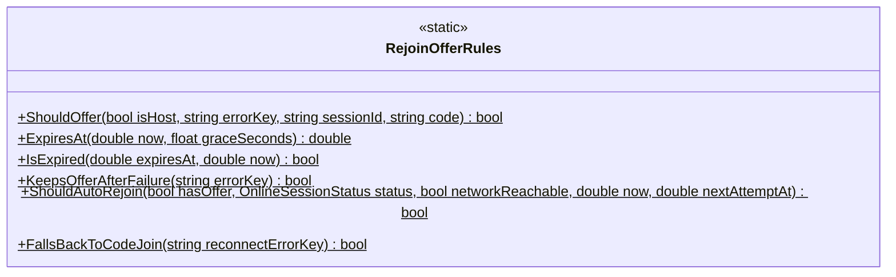

# RejoinOfferRules

> Pure rules of the client's reconnection offer: when a drop arms it, until when it lasts and whether a failed rejoin keeps it for another try. Times are Time.realtimeSinceStartupAsDouble seconds.

**Módulo:** [[Modulo Networking|Networking]] · **Namespace:** `AlienFarms.Networking.Session` · **Archivo:** `Assets/Scripts/Networking/Session/RejoinOfferRules.cs`

## Diagrama

## Usa
[[OnlineSessionErrorKeys]], [[OnlineSessionStatus]]

## Usado por
[[OnlineSessionService]], [[RelaySessionConnection]], [[SessionExit]]
