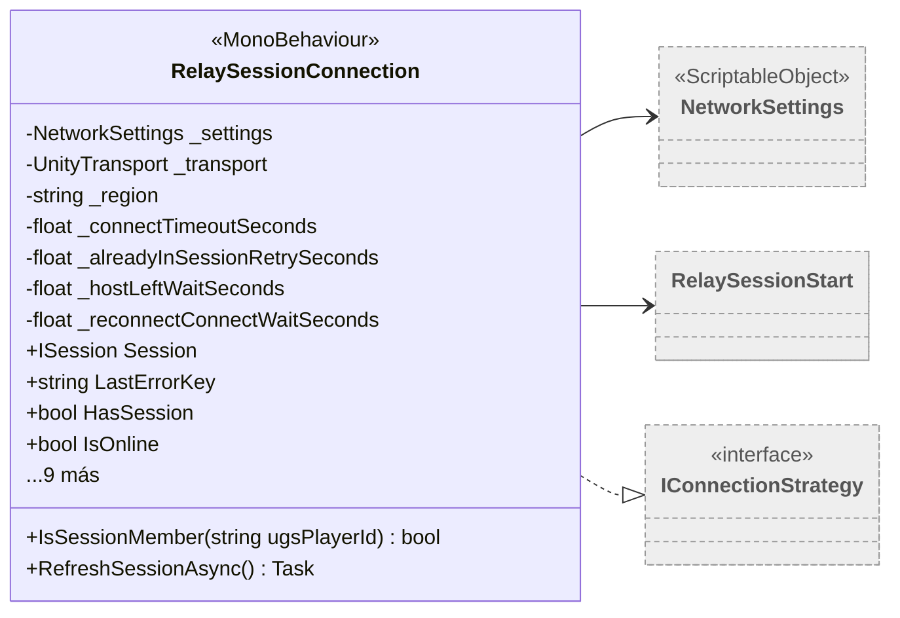

# RelaySessionConnection

> Connection through Unity Sessions + Relay: the host creates a private session with a Relay network (join code shown to the other player) and the client joins it by code. NGO is started by `NgoSessionNetworkHandler` on the root's own NetworkManager, after the caller wrote `NetworkConfig.ConnectionData`, so payload and approval work exactly as with `DirectConnection`. Requires a signed-in player (`UgsBootstrapper`). Each create / join returns its own `RelaySessionStart`; the caller `Adopt`s it as the current session or leaves that instance with `LeaveAsync(RelaySessionStart)`.

**Módulo:** [[Modulo Networking|Networking]] · **Namespace:** `AlienFarms.Networking.Session` · **Archivo:** `Assets/Scripts/Networking/Session/RelaySessionConnection.cs`

## Hereda / implementa
`MonoBehaviour`, [[IConnectionStrategy]]

## Diagrama

## Usa
[[IConnectionStrategy]], [[MembershipMatch]], [[MembershipRules]], [[NetworkSettings]], [[NgoSessionNetworkHandler]], [[OnlineSessionErrorKeys]], [[OnlineSessionErrorMapper]], [[RejoinOfferRules]], [[RelaySessionStart]], [[SessionSdkWorkarounds]]

## Usado por
[[ConnectionApprovalHandler]], [[OnlineSessionService]], [[SessionExit]]
