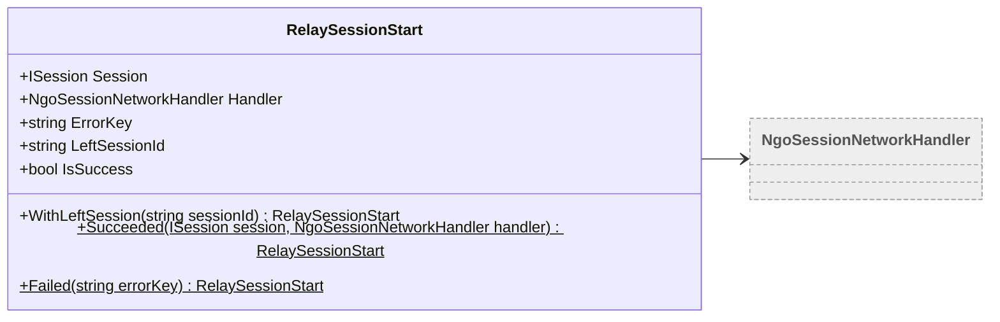

# RelaySessionStart

> Outcome of one create / join through `RelaySessionConnection`: the session and the network handler of that start only. Late cleanup (a start that finished after a Leave or a root teardown) acts on this instance, never on whatever session is current by then.

**Módulo:** [[Modulo Networking|Networking]] · **Namespace:** `AlienFarms.Networking.Session` · **Archivo:** `Assets/Scripts/Networking/Session/RelaySessionStart.cs`

## Diagrama

## Usa
[[NgoSessionNetworkHandler]]

## Usado por
[[OnlineSessionService]], [[RelaySessionConnection]], [[SessionExit]]
