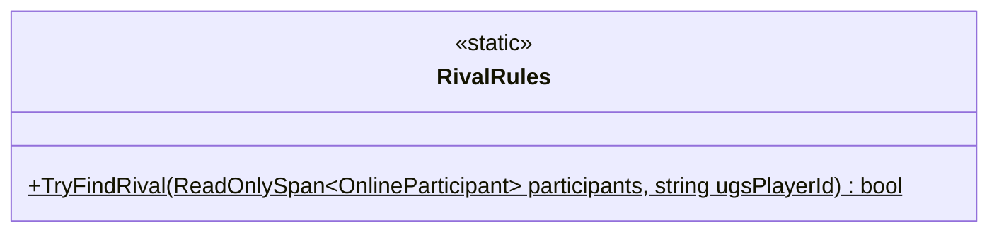

# RivalRules

> Whose public stats the online room shows as the rival's. No allocation.

**Módulo:** [[Modulo Networking|Networking]] · **Namespace:** `AlienFarms.Networking.Persistence` · **Archivo:** `Assets/Scripts/Networking/Persistence/RivalRules.cs`

## Diagrama

## Usa
[[OnlineParticipant]]

## Usado por
[[PlayerStatsSync]]
