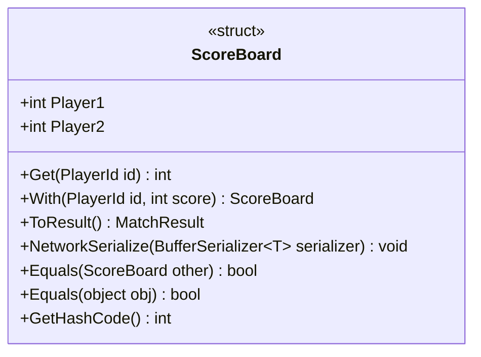

# ScoreBoard

> Both players' published scores. The match result is derived from it (no result message).

**Módulo:** [[Modulo Networking|Networking]] · **Namespace:** `AlienFarms.Networking.Match` · **Archivo:** `Assets/Scripts/Networking/Match/ScoreBoard.cs`

## Hereda / implementa
`INetworkSerializable`, `IEquatable`

## Diagrama

## Usa
[[MatchResult]], [[PlayerId]]

## Usado por
[[NetworkMatchState]]
