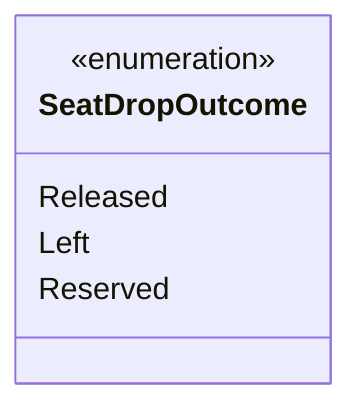

# SeatDropOutcome

> What the server does with the seat of a client that disconnected (see `SeatGraceRules.OnDisconnect`).

**Módulo:** [[Modulo Networking|Networking]] · **Namespace:** `AlienFarms.Networking.Session` · **Archivo:** `Assets/Scripts/Networking/Session/SeatDropOutcome.cs`

## Hereda / implementa
`byte`

## Diagrama

## Valores
`Released`, `Left`, `Reserved`

## Usado por
[[ConnectionApprovalHandler]], [[SeatGraceRules]]
