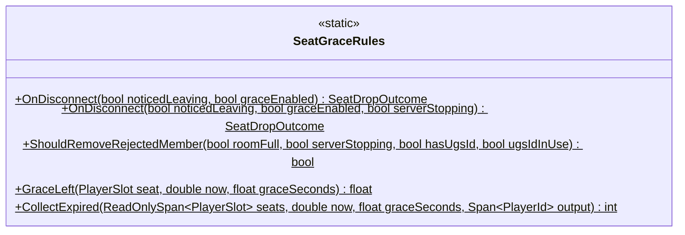

# SeatGraceRules

> Pure rules of the reconnection grace on the server: what a disconnection does to a seat, which reservations expired and how much grace is left. Times are Time.realtimeSinceStartupAsDouble seconds.

**Módulo:** [[Modulo Networking|Networking]] · **Namespace:** `AlienFarms.Networking.Session` · **Archivo:** `Assets/Scripts/Networking/Session/SeatGraceRules.cs`

## Diagrama

## Usa
[[ApprovalRules]], [[PlayerId]], [[PlayerSlot]], [[SeatDropOutcome]]

## Usado por
[[ConnectionApprovalHandler]]
