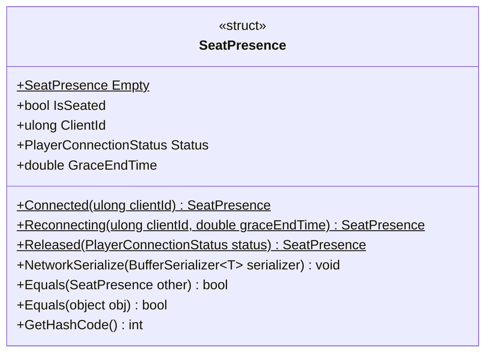

# SeatPresence

> Replicated presence of one player seat: who holds it and its `PlayerConnectionStatus`. A seat held for a dropped player is `PlayerConnectionStatus.Reconnecting` until `GraceEndTime` (server time). A free seat keeps how it was last released (Left / TimedOut), or Connected when it was never released. Fixed 18 bytes on the wire.

**Módulo:** [[Modulo Networking|Networking]] · **Namespace:** `AlienFarms.Networking.Match` · **Archivo:** `Assets/Scripts/Networking/Match/SeatPresence.cs`

## Hereda / implementa
`INetworkSerializable`, `IEquatable`

## Diagrama

## Usa
[[PlayerConnectionStatus]], [[Status]]

## Usado por
[[NetworkSeatPresence]], [[ReconnectGraceRules]], [[SeatPresenceBoard]], [[SeatPresenceRules]]
