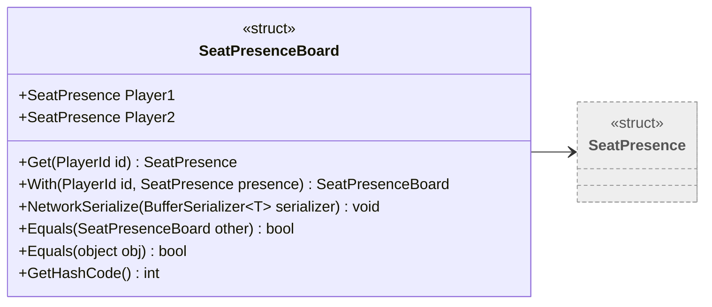

# SeatPresenceBoard

> Presence of both player seats, replicated by `NetworkSeatPresence`. Written whole by the server (rebuilt from the seat table), so it stays a small fixed-size value (36 bytes).

**Módulo:** [[Modulo Networking|Networking]] · **Namespace:** `AlienFarms.Networking.Match` · **Archivo:** `Assets/Scripts/Networking/Match/SeatPresenceBoard.cs`

## Hereda / implementa
`INetworkSerializable`, `IEquatable`

## Diagrama

## Usa
[[PlayerId]], [[SeatPresence]]

## Usado por
[[NetworkSeatPresence]], [[ReconnectGraceCoordinator]], [[ReconnectGraceRules]], [[SeatPresenceRules]]
