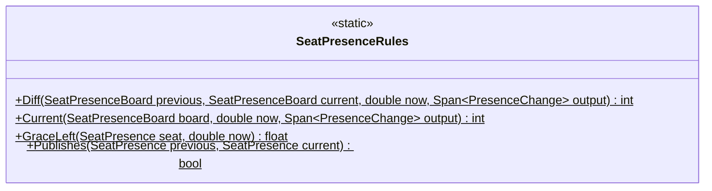

# SeatPresenceRules

> Pure rules of `NetworkSeatPresence`: which `PresenceChange`s a board transition publishes. No allocation.

**Módulo:** [[Modulo Networking|Networking]] · **Namespace:** `AlienFarms.Networking.Match` · **Archivo:** `Assets/Scripts/Networking/Match/SeatPresenceRules.cs`

## Diagrama

## Usa
[[PlayerConnectionStatus]], [[PlayerId]], [[PresenceChange]], [[SeatPresence]], [[SeatPresenceBoard]], [[Status]]

## Usado por
[[NetworkSeatPresence]]
