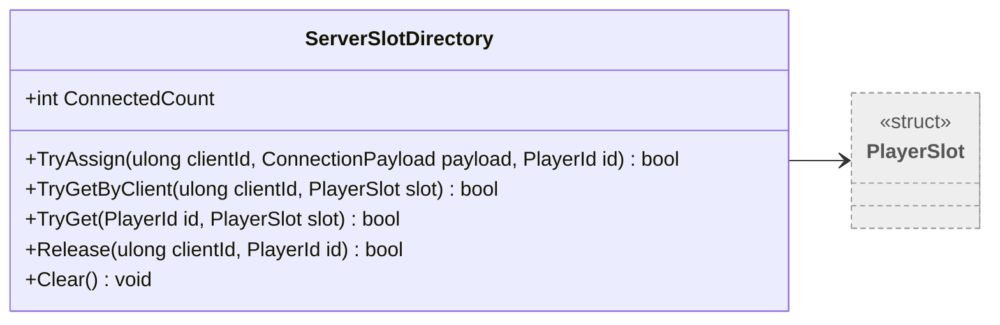

# ServerSlotDirectory

> Server-side seat table: which client holds Player1 / Player2. Plain C#, owned by the approval handler and shared with the roster through the runtime anchor. Version 1.5: a seat is freed as soon as its client disconnects.

**Módulo:** [[Modulo Networking|Networking]] · **Namespace:** `AlienFarms.Networking.Session` · **Archivo:** `Assets/Scripts/Networking/Session/ServerSlotDirectory.cs`

## Diagrama

## Usa
[[ConnectionPayload]], [[PlayerId]], [[PlayerSlot]]

## Usado por
[[ConnectionApprovalHandler]], [[NetworkPlayerRoster]], [[NetworkRuntimeAnchor]]
