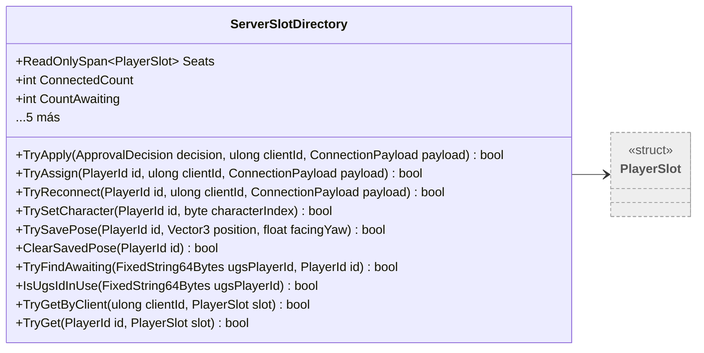

# ServerSlotDirectory

> Server-side seat table: which client holds Player1 / Player2. Plain C#, owned by the approval handler and shared with the roster and the room through the runtime anchor. A seat is freed with `Release`, or kept for its player with `MarkDisconnected` until it reconnects (`ApprovalOutcome.Reconnect`) or `ReleaseExpired` drops it (grace, from 2.7).

**Módulo:** [[Modulo Networking|Networking]] · **Namespace:** `AlienFarms.Networking.Session` · **Archivo:** `Assets/Scripts/Networking/Session/ServerSlotDirectory.cs`

## Diagrama

## Usa
[[ApprovalDecision]], [[ApprovalOutcome]], [[ApprovalRules]], [[ConnectionPayload]], [[PlayerId]], [[PlayerSlot]]

## Usado por
[[ApprovalPolicy]], [[ConnectionApprovalHandler]], [[NetworkLobbyState]], [[NetworkPlayerRoster]], [[NetworkRuntimeAnchor]], [[ReconnectGraceCoordinator]]
