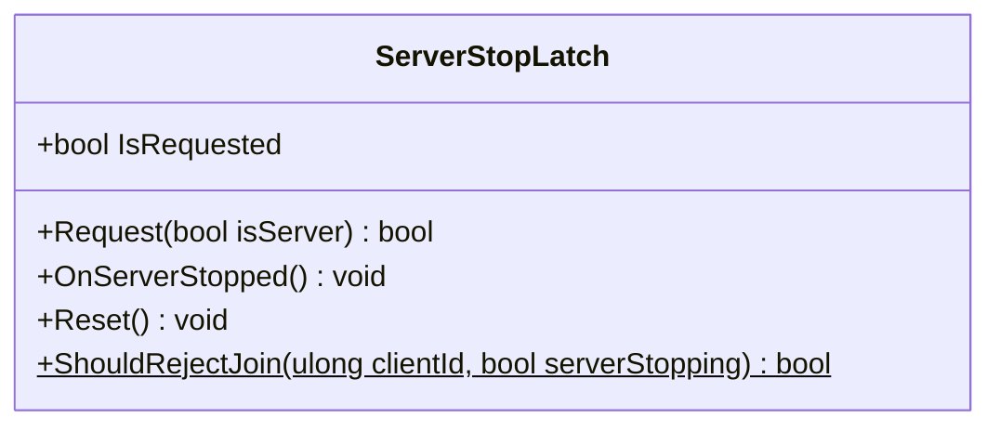

# ServerStopLatch

> "The host is leaving" state of the server's connection handling (plain C#, owned by `ConnectionApprovalHandler`). Requested when the root starts the host's leave; from then the run's disconnections are the shutdown, not drops. It lasts exactly one run: cleared when NGO reports the server stopped (the seat table is cleared in the same step, so a late disconnection finds nothing to reserve) and again when a new session starts, since the root survives a Leave in the lobby and is reused for the next room.

**Módulo:** [[Modulo Networking|Networking]] · **Namespace:** `AlienFarms.Networking.Session` · **Archivo:** `Assets/Scripts/Networking/Session/ServerStopLatch.cs`

## Diagrama

## Usado por
[[ConnectionApprovalHandler]]
