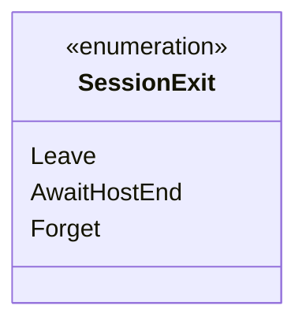

# SessionExit

**Módulo:** [[Modulo Networking|Networking]] · **Namespace:** `AlienFarms.Networking.Session` · **Archivo:** `Assets/Scripts/Networking/Session/OnlineSessionService.cs`

## Diagrama

## Valores
`Leave`, `AwaitHostEnd`, `Forget`

## Usa
[[ConnectionApprovalHandler]], [[ConnectionPayload]], [[DisplayNameResolver]], [[DisplayNameSanitizer]], [[GameMode]], [[MatchSession]], [[NetworkRootLifetime]], [[NetworkRuntimeAnchor]], [[NetworkSettings]], [[OnlineModeRules]], [[OnlineParticipant]], [[OnlineSessionChannel]], [[OnlineSessionErrorKeys]], [[OnlineSessionErrorMapper]], [[OnlineSessionStatus]], [[PlayerId]], [[RejoinOfferRules]], [[RelaySessionConnection]], [[RelaySessionStart]], [[Status]], [[UgsBootstrapper]]
