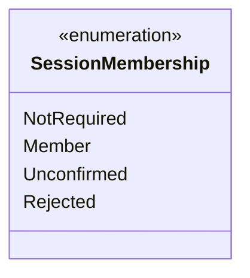

# SessionMembership

> Whether the UGS player id a client declared in its `ConnectionPayload` belongs to the host's online session (`ApprovalRules.CheckMembership`).

**Módulo:** [[Modulo Networking|Networking]] · **Namespace:** `AlienFarms.Networking.Session` · **Archivo:** `Assets/Scripts/Networking/Session/SessionMembership.cs`

## Diagrama

## Valores
`NotRequired`, `Member`, `Unconfirmed`, `Rejected`

## Usado por
[[ApprovalRules]], [[ConnectionApprovalHandler]]
