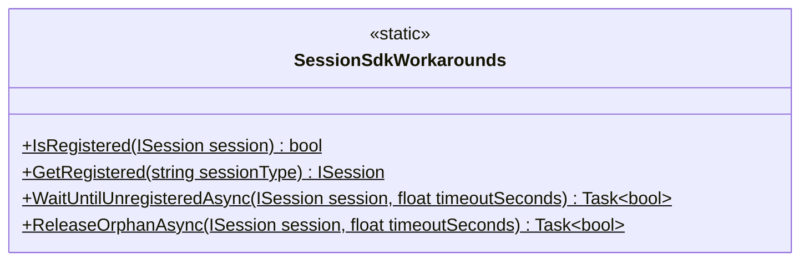

# SessionSdkWorkarounds

> Workarounds for com.unity.services.multiplayer 2.4.1. ISession.LeaveAsync() first unsubscribes from the lobby's deleted / kicked events and then removes the player; when the lobby is already gone that call throws (404) before the session reaches Disconnected or raises RemovedFromSession, and the SDK only drops a session from `IMultiplayerService.Sessions` on those events. The orphan keeps its session type registered, so every later create / join is refused as "already registered". `ReleaseOrphanAsync` raises the session's own (private) removal handler, which makes the SDK release its local state and the registration exactly as if the player had been kicked. If the private API is missing (another SDK version) it logs one warning and does nothing. Remove once the SDK fixes LeaveAsync.

**Módulo:** [[Modulo Networking|Networking]] · **Namespace:** `AlienFarms.Networking.Session` · **Archivo:** `Assets/Scripts/Networking/Session/SessionSdkWorkarounds.cs`

## Diagrama

## Usado por
[[RelaySessionConnection]]
