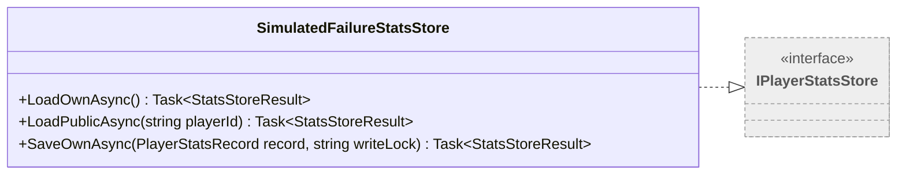

# SimulatedFailureStatsStore

> Decorator that makes every call fail as offline (retryable) without touching the network while shouldFail is true (read on every call, so it can be toggled at runtime). Driven by NetworkSettings.SimulateStatsFailure, which is always false outside the Editor and development builds.

**Módulo:** [[Modulo Networking|Networking]] · **Namespace:** `AlienFarms.Networking.Persistence` · **Archivo:** `Assets/Scripts/Networking/Persistence/SimulatedFailureStatsStore.cs`

## Hereda / implementa
[[IPlayerStatsStore]]

## Diagrama

## Usa
[[IPlayerStatsStore]], [[PlayerProgressErrorKeys]], [[PlayerStatsRecord]], [[StatsStoreResult]]

## Usado por
[[CloudSaveStatsService]]
