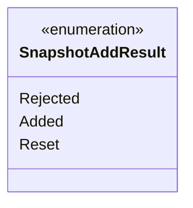

# SnapshotAddResult

> What `SnapshotBuffer.Add` did with a snapshot.

**Módulo:** [[Modulo Networking|Networking]] · **Namespace:** `AlienFarms.Networking.Prediction` · **Archivo:** `Assets/Scripts/Networking/Prediction/SnapshotAddResult.cs`

## Diagrama

## Valores
`Rejected`, `Added`, `Reset`

## Usado por
[[NetworkPlayerMotion]], [[SnapshotBuffer]]
