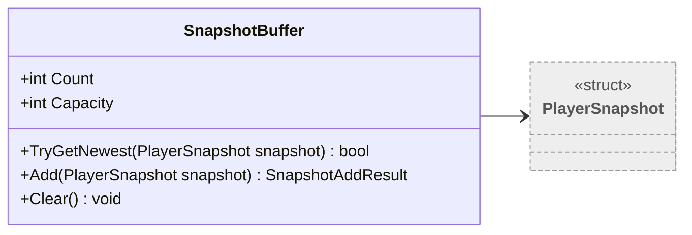

# SnapshotBuffer

> Fixed ring of received `PlayerSnapshot`s, oldest first and strictly increasing by tick. Out-of-order or duplicate snapshots are dropped; when full the oldest is overwritten. A snapshot from another `PlayerSnapshot.TeleportEpoch` clears the history, so all buffered snapshots share one epoch and nothing ever interpolates across a teleport.

**Módulo:** [[Modulo Networking|Networking]] · **Namespace:** `AlienFarms.Networking.Prediction` · **Archivo:** `Assets/Scripts/Networking/Prediction/SnapshotBuffer.cs`

## Diagrama

## Usa
[[PlayerSnapshot]], [[SnapshotAddResult]]

## Usado por
[[NetworkPlayerMotion]], [[SnapshotInterpolator]]
