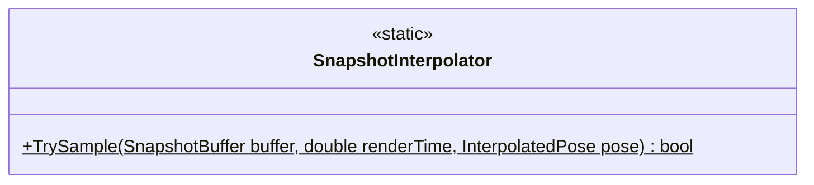

# SnapshotInterpolator

> Samples a `SnapshotBuffer` at a render time (server clock): linear between the two snapshots around it, clamped to the oldest / newest outside the range (no extrapolation). Teleports never blend: the buffer only holds snapshots of one teleport epoch.

**Módulo:** [[Modulo Networking|Networking]] · **Namespace:** `AlienFarms.Networking.Prediction` · **Archivo:** `Assets/Scripts/Networking/Prediction/SnapshotInterpolator.cs`

## Diagrama

## Usa
[[InterpolatedPose]], [[PlayerSnapshot]], [[SnapshotBuffer]]

## Usado por
[[NetworkPlayerMotion]]
