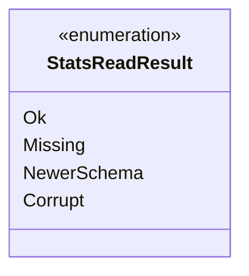

# StatsReadResult

> Outcome of decoding persisted stats (cloud record or local pending).

**Módulo:** [[Modulo Networking|Networking]] · **Namespace:** `AlienFarms.Networking.Persistence` · **Archivo:** `Assets/Scripts/Networking/Persistence/StatsReadResult.cs`

## Diagrama

## Valores
`Ok`, `Missing`, `NewerSchema`, `Corrupt`

## Usado por
[[CloudSavePlayerStatsStore]], [[PendingStatsCodec]], [[PlayerPrefsPendingStatsStore]], [[PlayerStatsCodec]], [[PlayerStatsLedger]], [[PlayerStatsSync]], [[StatsStoreResult]]
