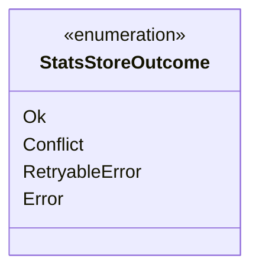

# StatsStoreOutcome

> How an `IPlayerStatsStore` call ended.

**Módulo:** [[Modulo Networking|Networking]] · **Namespace:** `AlienFarms.Networking.Persistence` · **Archivo:** `Assets/Scripts/Networking/Persistence/StatsStoreOutcome.cs`

## Diagrama

## Valores
`Ok`, `Conflict`, `RetryableError`, `Error`

## Usado por
[[PlayerStatsSync]], [[StatsStoreResult]]
