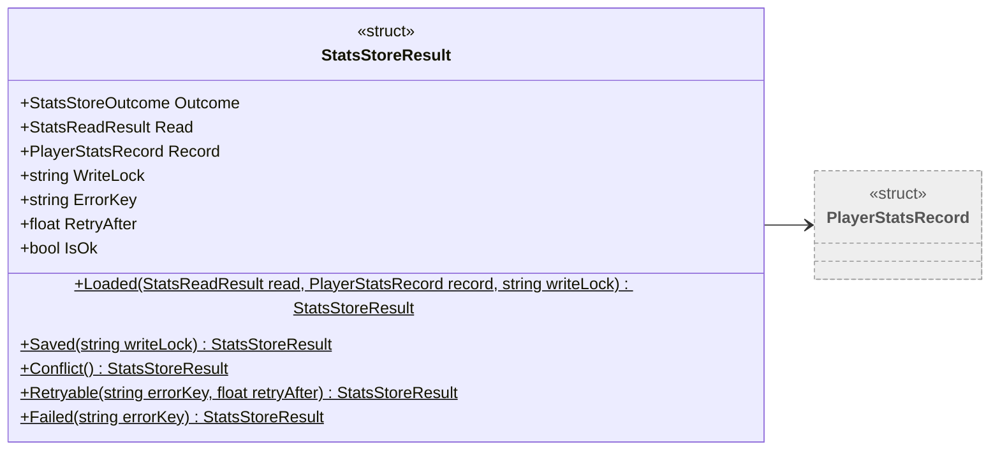

# StatsStoreResult

> Outcome of an `IPlayerStatsStore` call, free of SDK types. A load carries the decoded `Record` (`Read`) and its `WriteLock`; a save carries the new write lock.

**Módulo:** [[Modulo Networking|Networking]] · **Namespace:** `AlienFarms.Networking.Persistence` · **Archivo:** `Assets/Scripts/Networking/Persistence/StatsStoreResult.cs`

## Diagrama

## Usa
[[PlayerProgressErrorKeys]], [[PlayerStatsRecord]], [[StatsReadResult]], [[StatsStoreOutcome]]

## Usado por
[[CloudSavePlayerStatsStore]], [[IPlayerStatsStore]], [[PlayerStatsSync]], [[SimulatedFailureStatsStore]]
