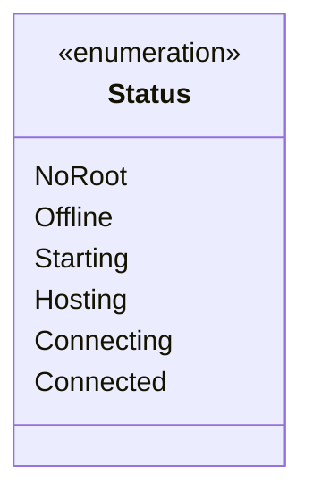

# Status

**Módulo:** [[Modulo Networking|Networking]] · **Namespace:** `AlienFarms.Networking.Diagnostics` · **Archivo:** `Assets/Scripts/Networking/Diagnostics/DevConnectionPanel.cs`

## Diagrama

## Valores
`NoRoot`, `Offline`, `Starting`, `Hosting`, `Connecting`, `Connected`

## Usa
[[CharacterRoster]], [[ConnectionPayload]], [[DirectConnection]], [[GameMode]], [[IConnectionStrategy]], [[MatchSession]], [[NetworkRootLifetime]], [[NetworkRuntimeAnchor]], [[NetworkSceneLoader]], [[NetworkSettings]], [[SceneFlow]], [[SceneNames]]

## Usado por
[[DevConnectionPanel]]
