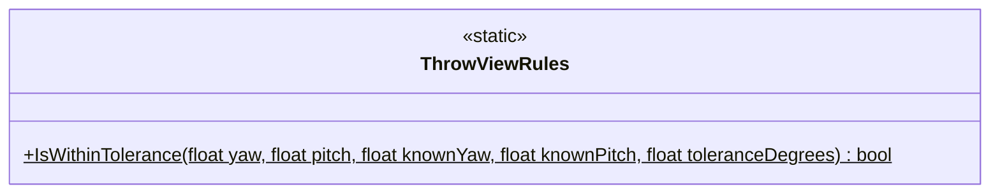

# ThrowViewRules

> Server check of a remote throw: the view the owner reports must be close to the last view the server knows for that player (from its input commands), within a tolerance on yaw (wrapped) and pitch.

**Módulo:** [[Modulo Networking|Networking]] · **Namespace:** `AlienFarms.Networking.Player` · **Archivo:** `Assets/Scripts/Networking/Player/ThrowViewRules.cs`

## Diagrama

## Usado por
[[Mode]], [[NetworkCarry]]
