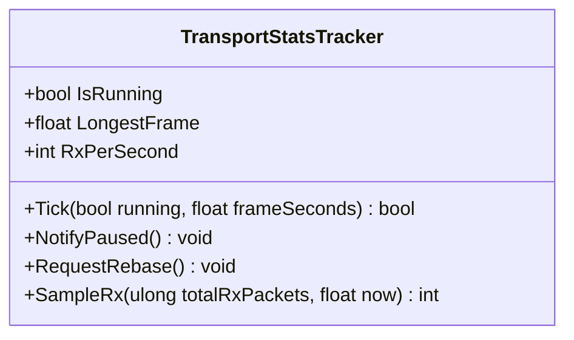

# TransportStatsTracker

> Pure per-session state of the transport lines of `PoolStatsView`: detects a new session (the driver started), tracks the longest frame of the session and turns the driver's cumulative received-packet count into a rate. Ticked every frame (visible or not); the rate is re-based whenever the view asks (e.g. shown again), so a hidden period never shows up as one averaged sample. A pause (editor pause or step, application suspended) is not a frame: `NotifyPaused` drops the next frame from the longest-frame record and re-bases the rate.

**Módulo:** [[Modulo Networking|Networking]] · **Namespace:** `AlienFarms.Networking.Diagnostics` · **Archivo:** `Assets/Scripts/Networking/Diagnostics/TransportStatsTracker.cs`

## Diagrama

## Usado por
[[PoolStatsView]]
