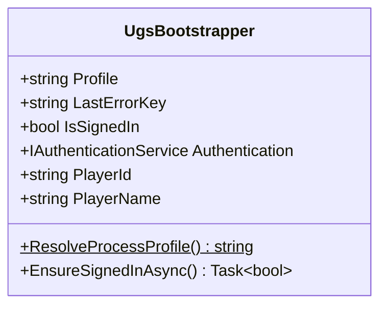

# UgsBootstrapper

> Initializes Unity Gaming Services (environment from NetworkSettings, one Authentication profile per Multiplayer Play Mode instance, see `UgsProfileResolver`) and signs in anonymously. Idempotent: concurrent calls share the pending attempt and a signed-in player returns at once; after a failure the next call retries. Plain class owned by `OnlineSessionService`; the UGS services themselves are global.

**Módulo:** [[Modulo Networking|Networking]] · **Namespace:** `AlienFarms.Networking.Session` · **Archivo:** `Assets/Scripts/Networking/Session/UgsBootstrapper.cs`

## Diagrama

## Usa
[[OnlineSessionErrorKeys]], [[OnlineSessionErrorMapper]], [[PlayerId]], [[UgsProfileResolver]]

## Usado por
[[DevConnectionPanel]], [[OnlineSessionService]], [[SessionExit]], [[Status]]
