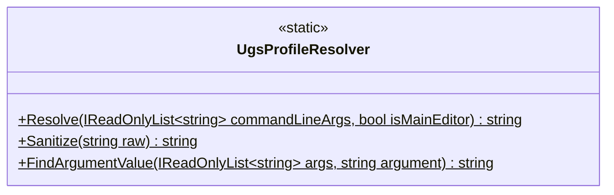

# UgsProfileResolver

> Picks the Unity Authentication profile of this process so every Multiplayer Play Mode instance (and every build started on the same PC) signs in as a different anonymous player. Editor PlayerPrefs are shared by the MPPM clones, so without a profile they would all reuse one session token and one PlayerId. Pure, so it is tested. Priority: an explicit -ugs-profile <name> argument, then the MPPM -name PlayerN argument of a virtual player; the main editor (and a build without arguments) keeps the default profile (null).

**Módulo:** [[Modulo Networking|Networking]] · **Namespace:** `AlienFarms.Networking.Session` · **Archivo:** `Assets/Scripts/Networking/Session/UgsProfileResolver.cs`

## Diagrama

## Usado por
[[UgsBootstrapper]]
