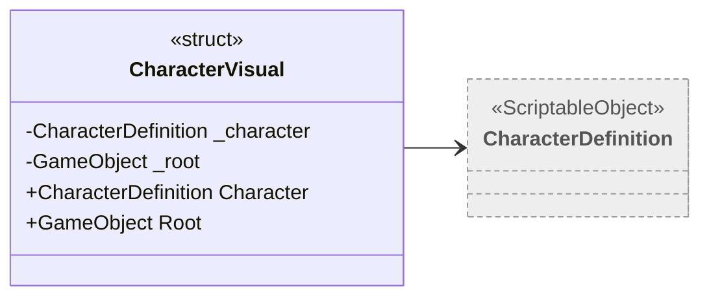

# CharacterVisual

> Pairs a character with its pre-built visual root inside the Player prefab.

**Módulo:** [[Modulo Player|Player]] · **Namespace:** `AlienFarms.Player` · **Archivo:** `Assets/Scripts/Player/CharacterVisual.cs`

## Diagrama

## Usa
[[CharacterDefinition]]

## Usado por
[[PlayerAppearance]]
