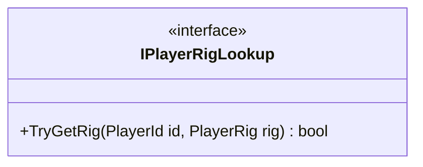

# IPlayerRigLookup

> Finds the rig of a player. What shared menus (pause, results) need: locally every joined player; online only the avatar this machine owns.

**Módulo:** [[Modulo Player|Player]] · **Namespace:** `AlienFarms.Player` · **Archivo:** `Assets/Scripts/Player/IPlayerRigLookup.cs`

## Derivados / implementaciones
[[IPlayerRoster]], [[LocalPlayerRigLookup]]

## Diagrama

## Usa
[[PlayerId]], [[PlayerRig]]

## Usado por
[[GameModeRouter]], [[IPlayerRoster]], [[LocalPlayerRigLookup]], [[PlayerMenuRouter]]
