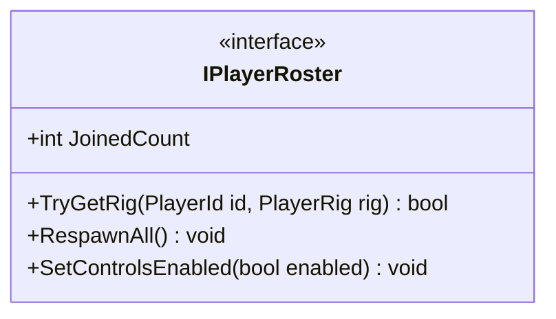

# IPlayerRoster

> Registry of the players in the match, as the match drives them. Local: `PlayerJoinCoordinator`; online, a network roster on the server.

**Módulo:** [[Modulo Player|Player]] · **Namespace:** `AlienFarms.Player` · **Archivo:** `Assets/Scripts/Player/IPlayerRoster.cs`

## Derivados / implementaciones
[[PlayerJoinCoordinator]]

## Diagrama

## Usa
[[PlayerId]], [[PlayerRig]]

## Usado por
[[MatchManager]], [[PlayerJoinCoordinator]]
