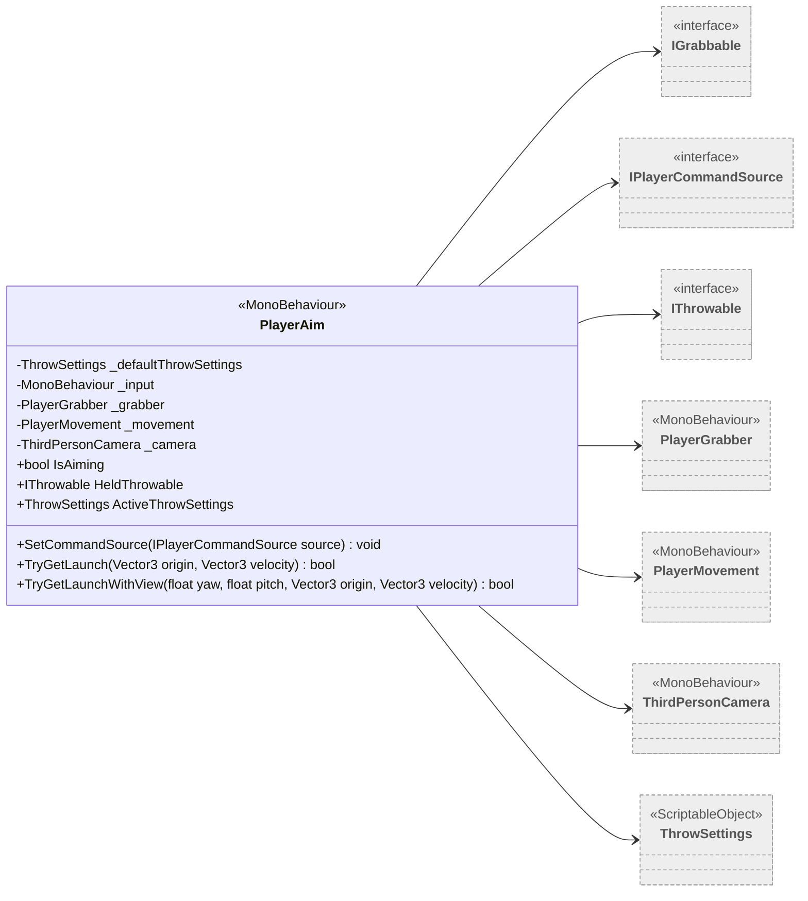

# PlayerAim

> Hold-to-aim for throws. Aiming is live: Aim held, grabbing enabled, not stunned and carrying something that can be thrown. While aiming, movement strafes facing the camera and the camera zooms in. The launch comes from the camera: planar forward for direction, pitch for elevation.

**Módulo:** [[Modulo Player|Player]] · **Namespace:** `AlienFarms.Player` · **Archivo:** `Assets/Scripts/Player/PlayerAim.cs`

## Hereda / implementa
`MonoBehaviour`

## Diagrama

## Usa
[[BallisticMath]], [[IGrabbable]], [[IPlayerCommandSource]], [[IThrowable]], [[LayerNames]], [[PlayerGrabber]], [[PlayerMovement]], [[ThirdPersonCamera]], [[ThrowSettings]]

## Usado por
[[Mode]], [[NetworkCarry]], [[NetworkPlayerInput]], [[PlayerGrabber]], [[PlayerRig]], [[ThrowTrajectoryView]]
