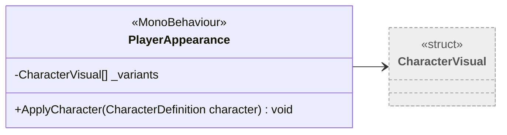

# PlayerAppearance

> Applies the player's character visual by activating one of the pre-built variants under the Visual child (no instantiation) and deactivating the rest.

**Módulo:** [[Modulo Player|Player]] · **Namespace:** `AlienFarms.Player` · **Archivo:** `Assets/Scripts/Player/PlayerAppearance.cs`

## Hereda / implementa
`MonoBehaviour`

## Diagrama

## Usa
[[CharacterDefinition]], [[CharacterVisual]]

## Usado por
[[PlayerRig]]
