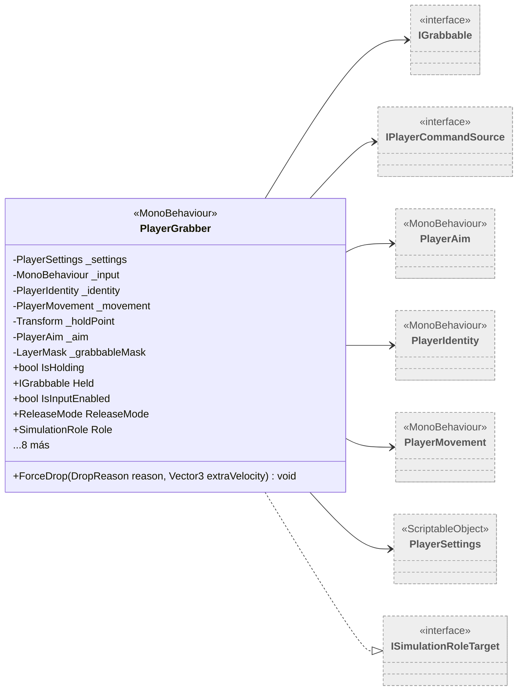

# PlayerGrabber

> Hold-to-carry grabbing: while Grab is held with empty hands, picks the closest `IGrabbable` in a cone in front of the player (also catching ones that walk into range, free or penned). Releasing Grab drops it in front, or throws it along the aimed arc while `PlayerAim` is aiming. Carries at most one object. With `ReleaseMode.External` the release is decided from outside (`ReleaseHeld`, `ThrowWithView`) instead of by the Grab button. As a `SimulationRole.Replica` it never grabs, drops or throws: it only mirrors the held object set with `SetReplicatedHeld`.

**Módulo:** [[Modulo Player|Player]] · **Namespace:** `AlienFarms.Player` · **Archivo:** `Assets/Scripts/Player/PlayerGrabber.cs`

## Hereda / implementa
`MonoBehaviour`, [[ISimulationRoleTarget]]

## Diagrama

## Usa
[[Animal]], [[Bomb]], [[DropReason]], [[IGrabbable]], [[IPlayerCommandSource]], [[ISimulationRoleTarget]], [[LayerNames]], [[PlayerAim]], [[PlayerId]], [[PlayerIdentity]], [[PlayerMovement]], [[PlayerSettings]], [[ReleaseMode]], [[SimulationRole]]

## Usado por
[[Mode]], [[NetworkPlayer]], [[NetworkPlayerInput]], [[PlayerAim]], [[PlayerRig]], [[PlayerStunReceiver]], [[PlayerTackle]]
