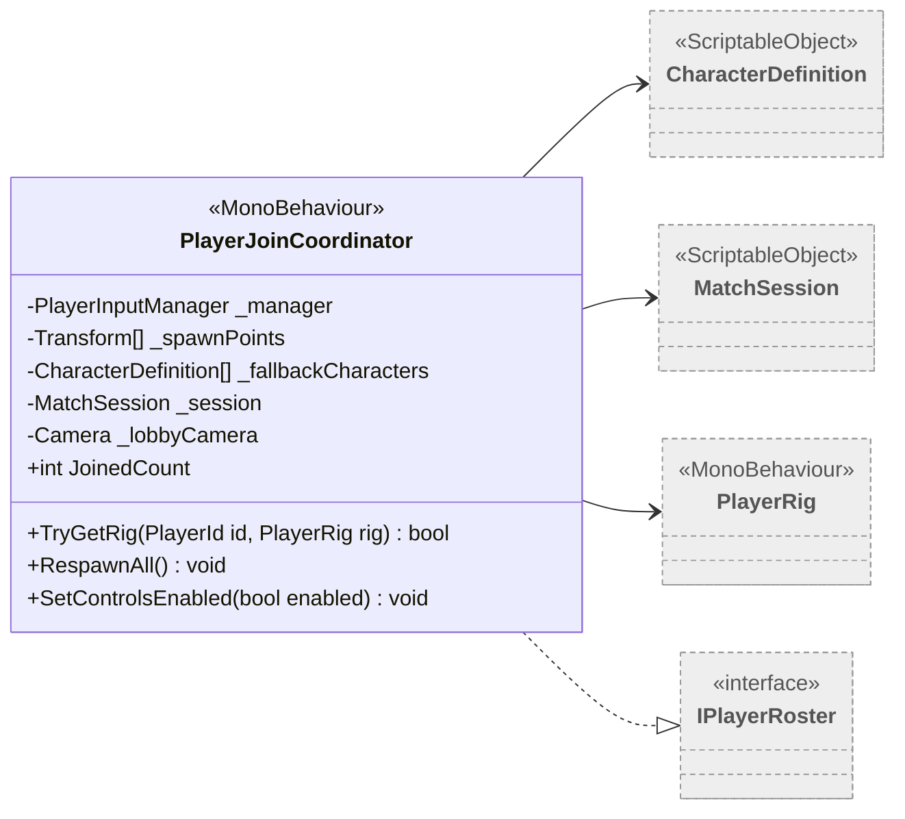

# PlayerJoinCoordinator

> Scene composition root for local multiplayer joining: listens to `PlayerInputManager` and configures each spawned player (identity, spawn point, camera yaw, character) through its `PlayerRig`. Keeps a registry of joined rigs for the match (count, respawn, freeze).

**Módulo:** [[Modulo Player|Player]] · **Namespace:** `AlienFarms.Player` · **Archivo:** `Assets/Scripts/Player/PlayerJoinCoordinator.cs`

## Hereda / implementa
`MonoBehaviour`, [[IPlayerRoster]]

## Diagrama

## Usa
[[CharacterDefinition]], [[GameEvents]], [[IPlayerRoster]], [[MatchSession]], [[PlayerId]], [[PlayerRig]], [[SessionSlot]]

## Usado por
[[MatchManager]], [[PlayerMenuRouter]]

## Eventos que publica
[[Eventos GameEvents#OnPlayerCharacterAssigned|OnPlayerCharacterAssigned]], [[Eventos GameEvents#OnPlayerJoined|OnPlayerJoined]], [[Eventos GameEvents#OnPlayerLeft|OnPlayerLeft]]
