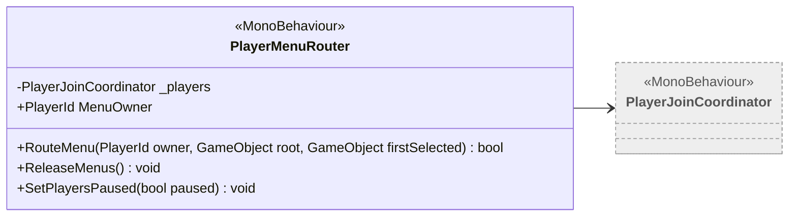

# PlayerMenuRouter

> Routes a shared menu (pause, results) to a single owner: the owner navigates it with its own event system while every other joined player is blocked. Also applies the game pause to every player. Players joining while a menu is routed or the game is paused get the same state.

**Módulo:** [[Modulo Player|Player]] · **Namespace:** `AlienFarms.Player` · **Archivo:** `Assets/Scripts/Player/PlayerMenuRouter.cs`

## Hereda / implementa
`MonoBehaviour`

## Diagrama

## Usa
[[GameEvents]], [[PlayerId]], [[PlayerJoinCoordinator]], [[PlayerMenuInput]], [[PlayerRig]]

## Usado por
[[PauseController]], [[ResultsMenuController]]

## Eventos que escucha
[[Eventos GameEvents#OnPlayerJoined|OnPlayerJoined]]
