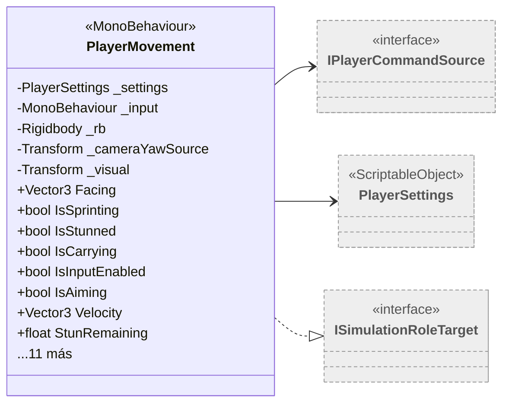

# PlayerMovement

> Camera-relative, Rigidbody-driven ground movement with walk/sprint speeds. The root never rotates; only `_visual` turns to face the move direction (or, while aiming, the camera's planar forward so the player strafes). Input comes from an `IPlayerCommandSource`. As a `SimulationRole.Replica` it does not move.

**Módulo:** [[Modulo Player|Player]] · **Namespace:** `AlienFarms.Player` · **Archivo:** `Assets/Scripts/Player/PlayerMovement.cs`

## Hereda / implementa
`MonoBehaviour`, [[ISimulationRoleTarget]]

## Diagrama

## Usa
[[IPlayerCommandSource]], [[ISimulationRoleTarget]], [[PlayerSettings]], [[SimulationRole]]

## Usado por
[[Mode]], [[NetworkPlayer]], [[NetworkPlayerInput]], [[NetworkPlayerMotion]], [[PlayerAim]], [[PlayerGrabber]], [[PlayerRig]], [[PlayerStunIndicator]], [[PlayerStunReceiver]], [[PlayerTackle]]
