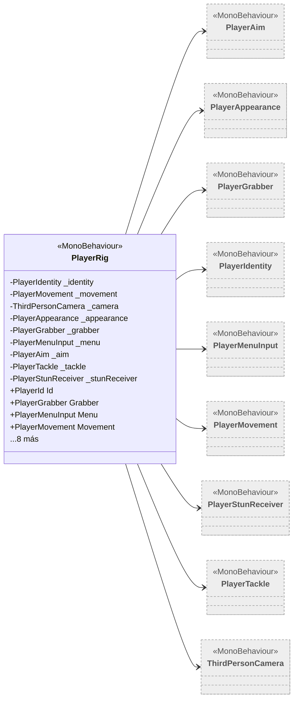

# PlayerRig

> Facade on the player root that groups the per-player components, so scene composition roots configure a spawned player through a single reference.

**Módulo:** [[Modulo Player|Player]] · **Namespace:** `AlienFarms.Player` · **Archivo:** `Assets/Scripts/Player/PlayerRig.cs`

## Hereda / implementa
`MonoBehaviour`

## Diagrama

## Usa
[[CharacterDefinition]], [[DropReason]], [[PlayerAim]], [[PlayerAppearance]], [[PlayerGrabber]], [[PlayerId]], [[PlayerIdentity]], [[PlayerMenuInput]], [[PlayerMovement]], [[PlayerStunReceiver]], [[PlayerTackle]], [[ThirdPersonCamera]]

## Usado por
[[IPlayerRoster]], [[PlayerJoinCoordinator]], [[PlayerMenuRouter]]
