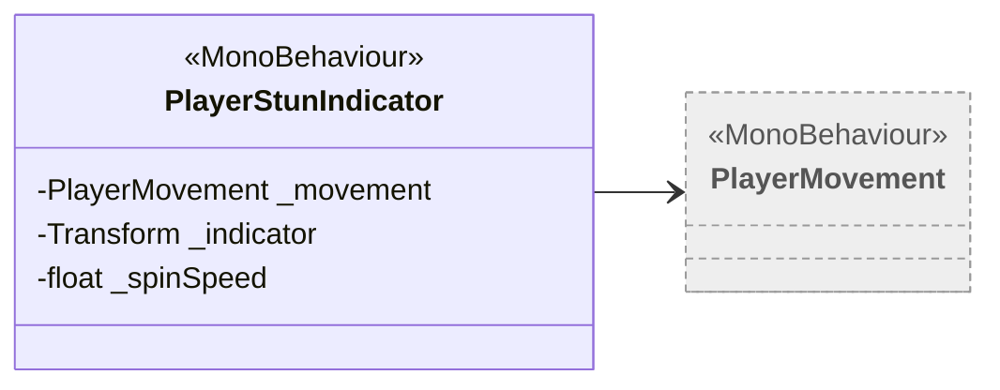

# PlayerStunIndicator

> Shows a spinning ring of stars over the player while it is stunned (blast or tackle).

**Módulo:** [[Modulo Player|Player]] · **Namespace:** `AlienFarms.Player` · **Archivo:** `Assets/Scripts/Player/PlayerStunIndicator.cs`

## Hereda / implementa
`MonoBehaviour`

## Diagrama

## Usa
[[PlayerMovement]]
